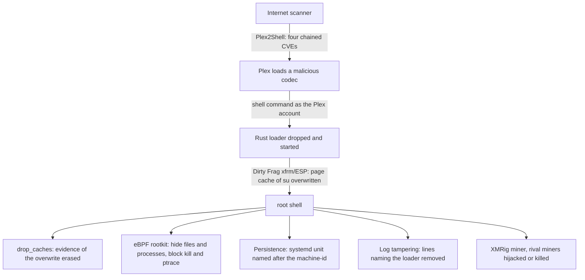

# Plex2Shell to Root

**How an unpatched media server became a rooted host in 25 seconds, and how the
proof sat unnoticed in the quarantine folder for a month.**

This repository documents a real compromise of an Internet-facing Linux server
in October 2026. It contains the full analysis, the indicators, detection rules
and a script to check your own machines. Everything that could identify the
victim has been removed; the attacker's infrastructure is listed in full.

- Full report: [`REPORT.md`](REPORT.md)
- Check a host now: [`tools/check_host.sh`](tools/check_host.sh)
- Indicators: [`iocs/iocs.csv`](iocs/iocs.csv)
- YARA rules: [`rules/plex2shell_loader.yar`](rules/plex2shell_loader.yar)

## What happened, in one paragraph

A server ran Plex Media Server 1.42.2 and a kernel that had been updated on
disk but never rebooted into. An automated cryptomining operation used the
public **Plex2Shell** exploit chain to run code as the Plex service account,
then dropped a Rust loader that escalated to root with the xfrm/ESP variant of
**Dirty Frag (CVE-2026-43284)**, loaded an **eBPF rootkit**, installed
persistence, edited a log file and started an XMRig miner. It did this twice,
54 hours apart. Two other unrelated groups were abusing the same Plex flaw on
the same machine during those days and never got past the service account.

## The attack chain



From the inbound exploit connection to root: about 25 seconds, both times, with
no human at the keyboard.

## Why this case is worth reading

1. **The escalation was "unproven" for a month.** Responders reproduced the
   kernel exploit on a replica and had a solid theory, but no artifact. The
   artifact existed all along: the quarantined loader contains the exploit code
   and the exact cleanup command that the kernel had logged. `strings` on the
   sample would have answered the question on day one.
2. **The incident was dated wrong.** The loader names its files after the host
   machine-id, so the second installation overwrote the first and every file
   timestamp pointed at the later date. Logs showed root 54 hours earlier.
3. **Scanners said the system was clean.** chkrootkit, rkhunter, debsums and
   ClamAV found nothing related to the loader. The rootkit runs in the kernel
   as eBPF programs and filters what those tools can see.
4. **The whole toolkit was recovered.** The embedded payloads are AES-256-GCM
   encrypted with a key stored in plain sight and a reused nonce. Six eBPF
   objects, the miner and its configuration were decrypted and are described in
   the report.
5. **The kernel fix was already installed.** Nobody had rebooted.

## Am I affected?

You are exposed to the same chain if both of these are true:

- You run Plex Media Server older than the release that fixes Plex2Shell, and
  it is reachable from the Internet.
- Your running kernel (not the installed one: check `uname -r`) lacks the fix
  for CVE-2026-43284, or for the two other exploits the loader carries,
  CVE-2026-31431 (Copy Fail) and CVE-2026-43500 (Dirty Frag, RxRPC).

Any other remote code execution bug would serve as the first step just as
well. The loader is not tied to Plex.

## Check a host

The loader does not use a fixed file name. It computes its names from
`/etc/machine-id`:

```
/usr/lib/.<first 16 hex of sha256(machine-id + "loader-bin-v1")>
/run/.<first 16 hex of sha256(machine-id + "loader-pid-v1")>
```

The script does that calculation for the host it runs on and also looks for
the persistence unit, the cron entry, the `LD_PRELOAD` marker and suspicious
page-cache drops in the kernel log. It only reads files.

```sh
sudo sh tools/check_host.sh                  # a live host
sudo ROOT=/mnt/image sh tools/check_host.sh  # a mounted disk, offline
```

| Exit status | Meaning |
| --- | --- |
| 0 | Nothing found |
| 1 | At least one hit, printed as `HIT:` lines |
| 2 | The check could not run |

A line starting with `LEAD:` is not a hit. It reports that a shell dropped the
page cache recently, which is also something administrators and tuning jobs do.

**How far to trust a clean result.** The rootkit filters directory listings but
not lookups by exact path, so the path test works even on an infected live
host. It is still stronger when run against a mounted disk or after a reboot.
A clean result says this loader is not installed; it says nothing about other
malware.

## Scan files with YARA

```sh
yara -r rules/plex2shell_loader.yar /path/to/scan
```

| Rule | Matches |
| --- | --- |
| `Plex2Shell_Rust_Loader` | The loader binary, on disk or dumped from memory |
| `Plex2Shell_Preload_Library` | The `LD_PRELOAD` library used when the loader has no root |
| `Plex2Shell_Su_Root_Shell_Payload` | The 184-byte ELF written over the cached image of `su` |
| `Plex2Shell_Loader_Persistence_Unit` | The systemd unit the loader installs |
| `Plex2Shell_eBPF_Rootkit_Object` | The six eBPF objects, once decrypted or dumped from memory |

The rules were run against the real samples (every piece matched its rule) and
against several thousand system files on two machines (no false positives).
They come from a single build of the loader, so a miss on another build is
inconclusive.

## What the toolkit does

| Part | What it does |
| --- | --- |
| Privilege escalation | Carries three public kernel exploits and tries them; here the xfrm/ESP variant of Dirty Frag worked |
| `hide_files`, `hide_pid` | Remove chosen files and processes from listings |
| `anti_ptrace` | Blocks debuggers and memory readers from its processes |
| `protect_signal` | Kills any process that tries to signal its processes |
| `ghost` | Returns blank content and zero size to anyone reading its files |
| `cleaner` | Watches every shell and downloader that starts and kills rival droppers |
| Wallet substitution | Rewrites Monero addresses in other miners so they pay this operator |
| Persistence | systemd unit; can also use cron, `rc.local`, `profile.d` and `LD_PRELOAD` |
| Log cleaning | Removes lines naming itself from system logs, login records and shell history |
| Miner | XMRig with nine pools and one wallet |

No code that collects or uploads credentials or files was found. One
obfuscation layer was not lifted, so the report rates that conclusion as
medium confidence and explains why.

## Lessons, briefly

- A kernel update counts only after the reboot.
- A media server does not belong on a host that matters. A container would not
  have helped: containers share the host kernel.
- Check what your container tooling changes. Here it had switched off the
  restriction on unprivileged user namespaces.
- Ship logs to another machine. Only local files were edited.
- After a root compromise, do not trust scanners running on the same host.
- Look inside what you quarantine.
- Date an incident from logs, not from file times.

The report expands each of these.

## Repository contents

| Path | What it is |
| --- | --- |
| `REPORT.md` | Timeline, evidence, how each alternative was ruled out, toolkit internals, detection guidance, lessons, indicators and limitations |
| `iocs/iocs.csv` | 34 indicators with columns `type,value,context,status` |
| `rules/plex2shell_loader.yar` | Five YARA rules |
| `tools/check_host.sh` | POSIX shell, read-only, no dependencies beyond `sha256sum` and `grep` |

In `iocs.csv`, `status` is `verified` when the indicator was confirmed in this
analysis and `reported` when it comes from the incident responders' notes.

## How the analysis was done

Read-only and static. No sample was executed. Sources were the responders'
evidence archive, the retained logs of the host, and reverse engineering of
the loader with radare2, objdump and readelf. The analysis was completed
before reading the responders' own conclusions and then compared with them;
both arrived at the same escalation vector by different routes.

The report states what was verified, what was inferred and what remains open.
Read its last section before relying on any single claim.

## What is not published here

No malware binaries, no packet captures, no decrypted payloads. The report
gives the hashes, plus the key and nonce that decrypt the loader's embedded
content, for analysts who hold the same sample.

## License

Use anything here as you like, including commercially and in modified form.
The one condition is that you credit the original author.

| What | License | File |
| --- | --- | --- |
| Code: `tools/` and `rules/` | MIT | [`LICENSE`](LICENSE) |
| Text and data: `README.md`, `REPORT.md`, `iocs/` | Creative Commons Attribution 4.0 (CC BY 4.0) | [`LICENSE-CC-BY-4.0.txt`](LICENSE-CC-BY-4.0.txt) |

Suggested credit: "Hugo L. Espuny, *Plex2Shell to Root*,
https://github.com/fakehec/plex2shell-to-root".

## Contact

Hugo L. Espuny, [github.com/fakehec](https://github.com/fakehec). Corrections
and additional sightings are welcome through the issue tracker.
